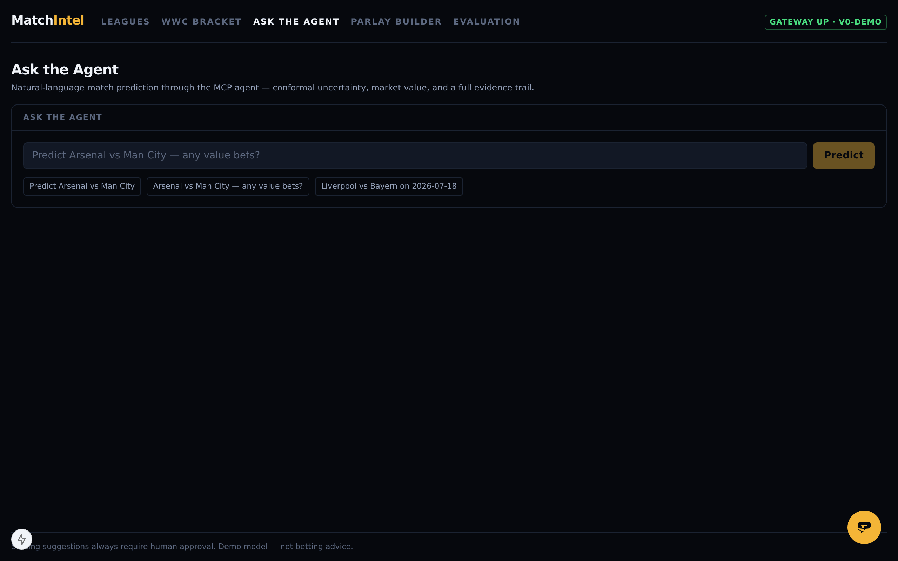
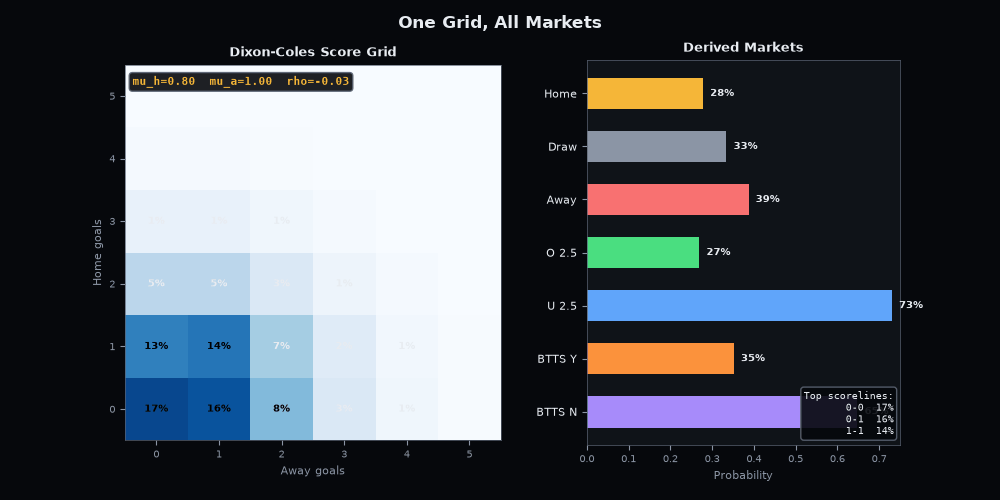
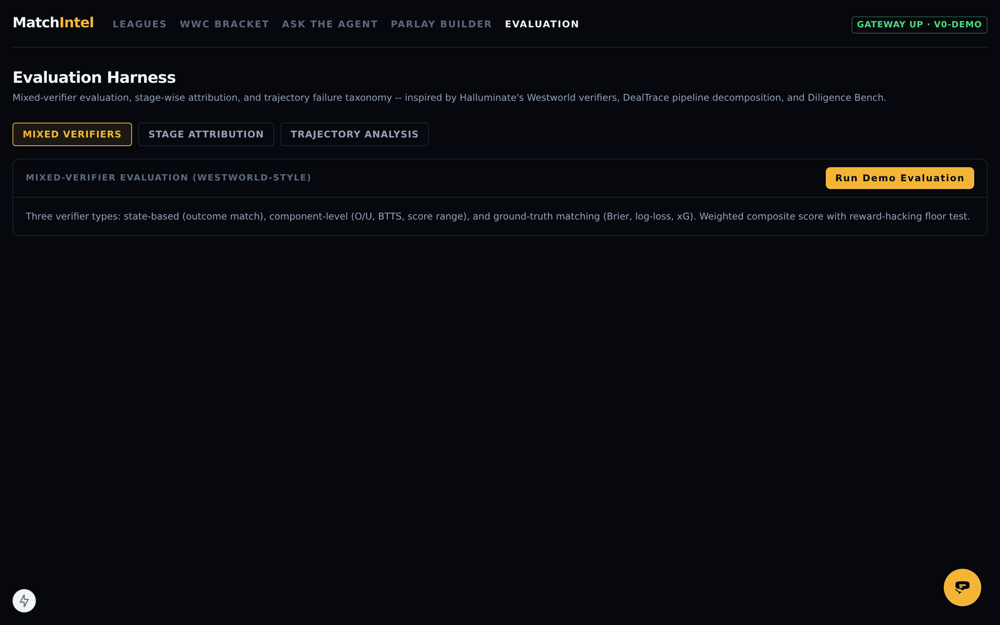
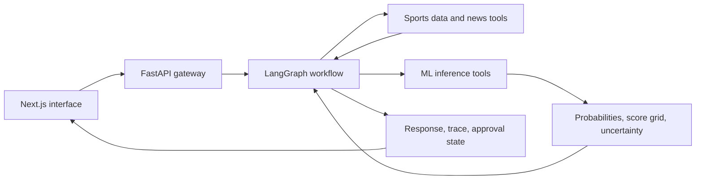

# Agentic Soccer — Forecasting and MCP Tools

**Explore a matchup, inspect the agent’s tool trace, and see the uncertainty behind a forecast.**

A Next.js interface and FastAPI gateway connect a LangGraph workflow to soccer-data, prediction, and evaluation tools. The repository also contains historical forecasting backtests and experimental reinforcement-learning environments.

[](https://agentic-soccer-match-prediction-mcp.vercel.app)

*Application demonstration. The served model bundle is trained on synthetic data; odds, squad, and news backends remain demos. Historical backtests below are separate from the hosted experience.*

[Open demo](https://agentic-soccer-match-prediction-mcp.vercel.app) · [Demo walkthroughs](#demo-walkthroughs) · [Try the fixture API](#try-the-fixture-api) · [Architecture](#how-it-works) · [Engineering reference](docs/engineering-reference.md) · [Agent Field mobile companion](https://github.com/joses2017smjh/MetaNavT/tree/main/mobile)

## Problem and approach

A forecast is difficult to assess when its data, model, and reasoning are hidden. This project exposes the prediction workflow: gather context, call the model, inspect probabilities and scorelines, and review the tool trace.

The implementation brings together the forecasting pipeline, agent orchestration, web interface, mobile adapter, and evaluation harness. Named external methods and data sources remain attributed in the [reference guide](docs/engineering-reference.md#references).

## What it does

- **Explore matchups:** show outcome probabilities, expected goals, likely scorelines, and uncertainty sets.
- **Inspect agent behavior:** expose tool calls, degraded components, and pending approval states.
- **Keep score markets consistent:** derive scorelines and related markets from a shared Dixon–Coles grid.
- **Evaluate separate layers:** compare historical forecasts with baselines, replay deterministic agent tasks, and test experimental policies in simulated/historical environments.
- **Serve mobile clients:** use a bounded, read-only adapter with explicit fixture provenance and authenticated live-gateway delegation.

## Demo walkthroughs

### One score grid, related probabilities

[](src/models/score_grid.py)

*Parameter-sweep visualization of the shared score grid. It explains how derived probabilities stay connected; it is not a live match forecast or an accuracy result.*

### Inspect the evaluation workflow

[](docs/engineering-reference.md#mixed-verifier-evaluation-harness)

*Recorded demo interface. The displayed component scores and “reward-hack safe” label describe this demonstration, not a fresh validation or a general robustness guarantee. Historical forecast results and deterministic agent tests are separate evaluations.*

## Evidence and limits

**Evidence checked October 14, 2026.** The latest committed EPL walk-forward report evaluates **1,520 matches across four folds**, using the 2019/20–2024/25 source seasons. This documentation refresh does not rerun the backtest. Lower log loss is better:

| Forecaster | Log loss |
| --- | ---: |
| Closing-market baseline | **0.9407** |
| Market-anchored model | 1.0229 |
| Naive baseline | 1.0652 |

The model improves on the naive baseline and trails the closing market. Empirical conformal coverage is **86.9% against a 90% target**. These results support a bounded historical comparison, not a claim of profitable forecasting or guaranteed future coverage. [Protocol, folds, and results](docs/backtest_epl.md).

The golden agent tasks use deterministic backends. Their published success and latency numbers do not establish live-provider reliability. RL transfer experiments, historical reports, and fixture visualizations remain in the [engineering reference](docs/engineering-reference.md); the hosted synthetic model is not their deployment result.

The separate [adaptive-conformal study](docs/conformal_study.md) records a different static baseline from the report above. Its adaptive-coverage numbers are not substituted for the main model's measured **86.9%** coverage or presented as the hosted configuration.

## How it works



| Concern | Source |
| --- | --- |
| Forecasting, calibration, and score grids | [`src/`](src/) |
| Workflow, swarm, state, and traces | [`agent/`](agent/) |
| Data, news, inference, code, and book tool implementations | [`mcp_servers/`](mcp_servers/) |
| API, web UI, and mobile adapter | [`gateway/`](gateway/), [`ui/`](ui/), [`gateway/mobile.py`](gateway/mobile.py) |
| Historical and policy evaluations | [`evals/`](evals/), [`envs/`](envs/), [`training/`](training/) |

**Engineering decisions:** start with a deterministic workflow for inspectable tool order; keep model artifacts behind the prediction layer; record degraded backends; separate synthetic demonstrations from historical evaluation. Local gateway calls use the in-process runner by default. Docker Compose uses MCP transport for its configured data, news, inference, and code services; additional book-tool code lives in the repository. [Detailed architecture](docs/engineering-reference.md#architecture).

## Try the fixture API

Use Git and Python **3.11+**. This small adapter serves recorded outputs from the synthetic model and workflow without loading a model or contacting a provider.

```bash
git clone https://github.com/joses2017smjh/Agentic-Soccer-Match-Prediction-MCP.git
cd Agentic-Soccer-Match-Prediction-MCP
python3.11 -m venv .venv
source .venv/bin/activate
python -m pip install 'fastapi>=0.111' 'uvicorn>=0.30' 'httpx>=0.27' 'pydantic>=2.7'
python -m uvicorn gateway.mobile:app --host 127.0.0.1 --port 8011
```

In another terminal:

```bash
curl -s http://localhost:8011/mobile/health
curl -s -X POST http://localhost:8011/mobile/predict \
  -H 'content-type: application/json' \
  -d '{"text":"Predict Arsenal vs Man City","mode":"demo"}'
```

This returns a labeled fixture response, not a newly executed agent prediction. [OpenAPI contract](gateway/fixtures/mobile.openapi.json) · [Fixture bundle and source/model hashes](gateway/fixtures/mobile_demo.json).

## Run the workflow and web interface

From the repository root, with the virtual environment active:

```bash
python -m pip install -e ".[dev]"
python -m scripts.build_demo_artifacts
DATA_BACKEND=demo python -m uvicorn gateway.app:app --host 127.0.0.1 --port 8000
```

The artifact builder trains a small synthetic bundle locally. In another terminal, with Node.js and npm installed:

```bash
cd ui
npm ci
GATEWAY_URL=http://localhost:8000 npm run dev
```

Open `http://localhost:3000`. [Dependency specification](pyproject.toml) · [UI scripts](ui/package.json) · [Docker Compose alternative](docker-compose.yml).

## Testing and deployment

The adapter tests need only the lightweight packages above plus pytest. `--noconftest` skips unrelated historical-data fixtures:

```bash
python -m pip install pytest
python -m pytest --noconftest -q tests/test_mobile.py
```

For the full suite, first install `.[dev]` and build the synthetic artifacts as shown above. The following preparation downloads six historical EPL seasons, validates them, and records source hashes:

```bash
python -m scripts.prepare_test_data
python -m pytest -q
```

A hosted frontend is linked above. Server deployment needs the gateway and its selected data/model services. Live mobile delegation requires explicit gateway configuration and a separate mobile access token; live mode alone does not imply real match data. [Mobile configuration](docs/engineering-reference.md#android-and-ios-companion-integration) · [Deployment and experimental commands](docs/engineering-reference.md#quick-start).

**Stack:** Python, FastAPI, LangGraph, MCP, XGBoost, scikit-learn, NumPy, Next.js, TypeScript, Docker, pytest.

[Jose Sanchez](https://github.com/joses2017smjh) · [Email](mailto:sanchej7@oregonstate.edu)
